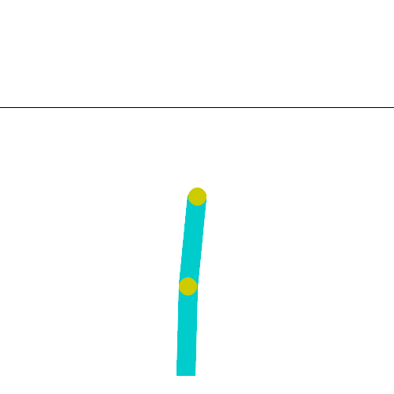

# Acrobot Example

`Acrobot` is a classic-control task in Gymnasium. It models a two-link
pendulum attached at a shoulder joint. The shoulder is unactuated; the agent
can apply torque only at the elbow joint. 

The goal is to swing the free end of
the lower link high enough to reach the target height. 

The animation below shows an example of the Acrobot's movement:

Link: [Gymnasium Acrobot documentation](https://gymnasium.farama.org/environments/classic_control/acrobot/)

## Observation

The environment returns a six-value observation describing the two link
angles and their angular velocities:

| Index | Meaning |
| --- | --- |
| `0` | Cosine of the first link angle, `cos(theta1)` |
| `1` | Sine of the first link angle, `sin(theta1)` |
| `2` | Cosine of the second link angle, `cos(theta2)` |
| `3` | Sine of the second link angle, `sin(theta2)` |
| `4` | Angular velocity of the first link, `theta1_dot` |
| `5` | Angular velocity of the second link, `theta2_dot` |

Each angle is represented by its sine and cosine instead of a single angle
value. To recover an angle from the observation, use
`math.atan2(sin_theta, cos_theta)`.

## Actions

The action space has three discrete choices. Torque is applied at the elbow
joint:

| Action | Effect |
| --- | --- |
| `0` | Apply negative torque |
| `1` | Apply no torque |
| `2` | Apply positive torque |

## Random policy example

[`random_policy.py`](./random_policy.py) is a baseline. At every step it samples
an action from the environment's action space without inspecting the observation. 

## State-based policy example

[`state_based_policy.py`](./state_based_policy.py) uses the observation to
choose torque direction. It converts the sine/cosine pairs back to angles with
`atan2`, reads the angular velocities, computes an `energy_signal`, and selects
action `2` when the signal is positive or action `0` otherwise. 

### Exercise: compare the state-based policy rules

In `state_based_policy.py`, compare the current energy-policy with the following state-based policies:

1. `2 * theta1_dot + theta2_dot`
2. `theta1_dot + theta2_dot + 0.5 * math.sin(theta2)`

Do these alternative policies reduce the number of iterations required to reach the goal?
