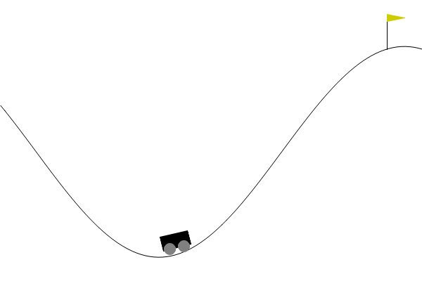

# MountainCar Example

`MountainCar` is a classic-control task in Gymnasium. A car is positioned
between two hills in a valley. Its engine is too weak to drive directly up the
steep hill, so the car must build momentum by moving back and forth between the
hills.

The goal is to drive the car to the goal at the top of the right hill. 

The animation below shows an example of the Acrobot's movement:

Link: [Gymnasium MountainCar documentation](https://gymnasium.farama.org/environments/classic_control/mountain_car/)

## Observation

The environment returns a two-value observation:

| Value | Meaning |
| --- | --- |
| `observation[0]` | Car position along the track |
| `observation[1]` | Car velocity |

## Actions

The action space is discrete:

| Action | Effect |
| --- | --- |
| `0` | Accelerate to the left |
| `1` | Do not accelerate |
| `2` | Accelerate to the right |

## Random policy example

[`random_policy.py`](./random_policy.py) samples an action from the action
space at each step without using the observation. 

## State-based policy example

[`state_based_policy.py`](./state_based_policy.py) uses the observed velocity
to choose a direction:

- If velocity is positive, it accelerates to the right (`action=2`).
- If velocity is negative, it accelerates to the left (`action=0`).
- If velocity is zero, it pushes right when position is greater than `-0.5`;
  otherwise, it pushes left.
